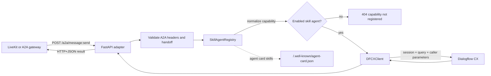

# Skill Agent Architecture

## Workflow

## Integration contract

The steering or gateway layer selects a capability and supplies a stable `session_id`. The adapter owns capability-to-agent routing and Dialogflow CX session construction. Dialogflow CX owns intent matching, page transitions, fulfillment, and response messages.

For each request, the adapter:

1. validates the A2A version, optional API key, and structured handoff;
2. resolves the normalized capability to one enabled registry entry;
3. creates the CX session path using project, location, agent, environment, and `session_id`;
4. sends the utterance with `ani`, `caller_name`, and `authenticated` parameters;
5. returns the CX query result with adapter metadata.

## Scalability model

Add a domain by adding an entry to `config/skill_agents.json`, setting its environment variables, and enabling it. No new route or code path is required. Each capability must be unique across enabled agents, which keeps routing deterministic.

The current registry includes:

| Agent | Capabilities | State |
| --- | --- | --- |
| IT Service Desk | `it service desk` | Enabled |
| HR | `pto balance`, `benefits enrollment`, `payroll question` | Disabled template |
| Finance | `expense report`, `invoice status`, `budget inquiry` | Disabled template |

For production scale-out, run multiple stateless adapter instances behind the gateway. Keep the same `session_id` for a conversation, use shared configuration and credentials, and monitor structured events such as `handoff_received`, `dfcx_result`, and `dfcx_request_failed`. The adapter currently performs synchronous request/response handling and does not provide streaming or push notifications.